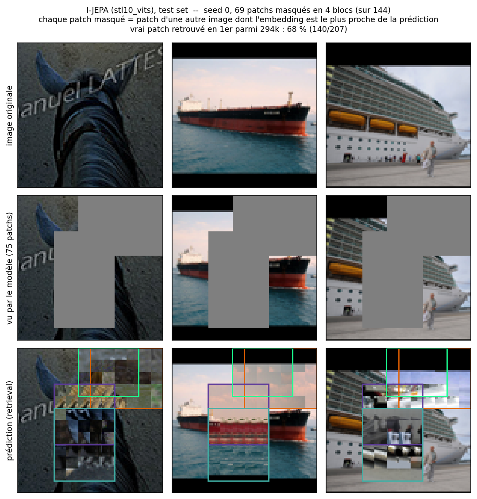

# Project progress

## Latest update: the ViT-Small on STL-10 is trained, 74.1% on the linear probe

The `stl10_vits` run finished on one GPU of the ETIS lab server (NVIDIA RTX PRO 6000 Blackwell): 100 epochs, 39,000 steps, ~112 s per epoch, about 3 h 10 in total. Details in [RESULTATS.md](result_analysis/RESULTATS.md) section 6.

| | `cifar10_d128` | `stl10_vits` |
|---|---|---|
| Final loss (last epoch) | 0.260 | 0.397 |
| Normalised std (ideal) | 0.087 (0.088) | 0.051 (0.051) |
| Dead dimensions | 0 | 0 |
| Effective rank per image, random → trained | 37 → 65 (max 128) | 94 → 228 (max 384) |
| Linear probe, random → trained | 45.0% → 56.6% (CIFAR-10) | 45.7% → **74.1%** (STL-10) |
| True patch retrieved (test set / `bird1.jpg`) | 51% / ~46% | **68%** / 51% |

The predictions now follow the layout of the scene, not only the local colours: the hull of the cargo ship is continued at the right height, with water below and sky above. On `bird1.jpg` ([`prediction_bird1_v3.png`](experimentation/prediction_bird1_v3.png)), blue now appears where the bird is, but its head and the branch are still not recovered.

- **No collapse.** The normalised std sits at its ideal value and no dimension is dead.
- **Much more useful representations.** The gain over a random encoder goes from +11.6 to **+28.4 points**. The two test sets differ, so the fair comparison will be with `stl10_d128` / `stl10_d256`.
- **The loss rose from 0.105 (epoch 3) to a peak of ~0.42 (epoch 65), then eased to ~0.39.** This is the usual JEPA shape: the EMA target gets richer, so it is harder to predict. Part of the rise comes from the scale of the embeddings (raw std 0.47 → 0.85), since the loss is an MSE on unnormalised targets. The I-JEPA paper normalises the targets; this is worth testing on a separate run.

### Setting up the server

- Python 3.12 environment made with `uv`, `requirements-gpu.txt`, and `LD_LIBRARY_PATH` set to the CUDA libraries installed by pip.
- Blackwell GPUs (compute capability 12.0) are not in the TensorFlow 2.21 binaries, so the kernels are compiled from PTX on the first run; `CUDA_CACHE_MAXSIZE` is raised so that this happens only once.
- The server cannot reach the STL-10 download site, so the dataset was copied from the local `~/tensorflow_datasets` with `scp`.
- The run goes in `tmux` with `--resume`, so it survives an SSH disconnection.

### Next steps

- Train `stl10_d128` / `stl10_d256` on the second GPU, to separate the effect of the model size from that of the data.
- Normalise the targets before the loss, as in the paper, on a separate run.

---

## Previous update: preparing a ViT-Small on STL-10 at 96x96 for the lab GPUs

The ETIS lab now gives access to GPUs. A larger model only helps if each image is cut into more patches and there is more data, so the next run changes the three together (branch `stl10-vits`, plan in [TODO.md](TODO.md) section 5):

| | `cifar10_d128` (done) | `stl10_vits` (next) |
|---|---|---|
| Data | CIFAR-10, 50k images, 32x32 | STL-10 unlabelled, 100k images, 96x96 |
| Patch grid | 8x8 = 64 tokens | 12x12 = 144 tokens |
| Encoder | width 128, 4 blocks, 4 heads | width 384, 12 blocks, 6 heads |
| Trainable weights | 0.92M | 24.2M |
| Hardware | local CPU, ~4 h | lab GPU |

### What was added

- **[`config.py`](jepa/config.py)**: the `stl10_96` dataset (native size, statistics recomputed at 96x96) and the `stl10_vits` preset (batch 256, 100 epochs, learning rate 5e-4).
- **[`train.py`](jepa/train.py)**:
  - the training step and the EMA are compiled with `tf.function`, with one trace for every mask size: ~2.4x faster on the local CPU, and the GPU is no longer waiting for Python;
  - `--resume` goes on from the last finished epoch (weights, optimizer, step, mask generator), needed with the time limit of cluster jobs.
- **[`linear_probe.py`](result_analysis/linear_probe.py)**: the first measure of how *useful* the representations are, not only of whether they are degenerate. On `cifar10_d128`: **56.6%** test accuracy, against 45.0% for a random encoder of the same architecture ([RESULTATS.md](result_analysis/RESULTATS.md) section 5).
- **[`visualise_model.py`](jepa/visualise_model.py)**: prints every layer with its output shape and weight count, and exports the encoder and the predictor for [Netron](https://netron.app).
- **Cluster**: [`requirements-gpu.txt`](requirements-gpu.txt) and a SLURM job script, [`scripts/train_slurm.sh`](scripts/train_slurm.sh).
- **Tests**: masks on the 12x12 grid, the new preset, the compiled step and the resume ([`tests/test_train.py`](tests/test_train.py)).

### Next steps (at the time)

Set the job script up on the cluster, run a 50-step smoke test to measure the time per step, then the full run. Its linear probe on STL-10 will be compared with a random encoder and with the smaller STL-10 runs.

---

## Earlier update: analysis of the pre-training run and tests on images outside CIFAR-10

Two folders were added: [`result_analysis/`](result_analysis/), which evaluates the 30-epoch run, and [`experimentation/`](experimentation/), which tests the model on our own images.

### What was added

- **[`plot_loss.py`](result_analysis/plot_loss.py)**: plots the loss logged every 50 steps in `logs/train.log` ([`loss_par_step.png`](result_analysis/loss_par_step.png)). It drops to 0.151 at step 550, rises to ~0.28 around epoch 15 as the EMA target gets richer, and ends at 0.265.
- **[`check_collapse.py`](result_analysis/check_collapse.py)**: measures the spread of the target encoder embeddings on 1024 test images, compared with a random encoder. No collapse: normalised std 0.087 (ideal ~0.088), no dead dimension, effective rank 65 per image (37 for the random encoder).
- **[`predicted_fill.py`](result_analysis/predicted_fill.py)**: I-JEPA predicts embeddings, not pixels, so each masked patch is shown as the test patch whose target embedding is nearest to the prediction ([`predicted_samples.png`](result_analysis/predicted_samples.png)). The true patch is the nearest neighbour in 51% of cases among 131k patches.
- **[`RESULTATS.md`](result_analysis/RESULTATS.md)**: summary of the unit tests (157 passed), the run, the collapse check and the predictions.
- **[`experimentation/test_image.py`](experimentation/test_image.py)**: crops and resizes any image in the folder to 32x32 and runs the same visualisation. Tried on [`img/bird1.jpg`](experimentation/img/bird1.jpg) ([`prediction_bird1_v1.png`](experimentation/prediction_bird1_v1.png)).

### Assessment

The pipeline works, but the predictions are clearly not good. On the bird image the true patch is found in only ~46% of cases, and the retrieved patches only match local colours and textures: with the head masked, the model fills it with brown-green background textures and never recovers the shape of the bird or the branch.

### Next steps (at the time)

- A larger embedding dimension.
- Re-training on a higher-resolution dataset (e.g. STL-10 or Tiny ImageNet at 64x64), since CIFAR-10 is only 32x32 and the model cannot run at another resolution without re-training.

The detailed plan for these next steps is in [TODO.md](TODO.md).
