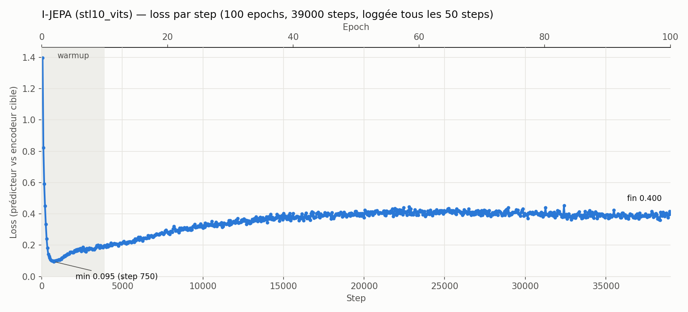
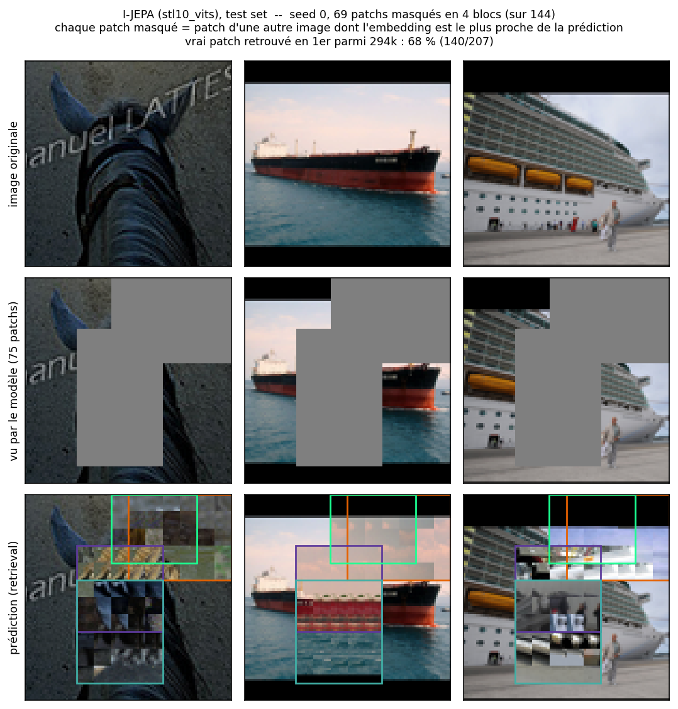
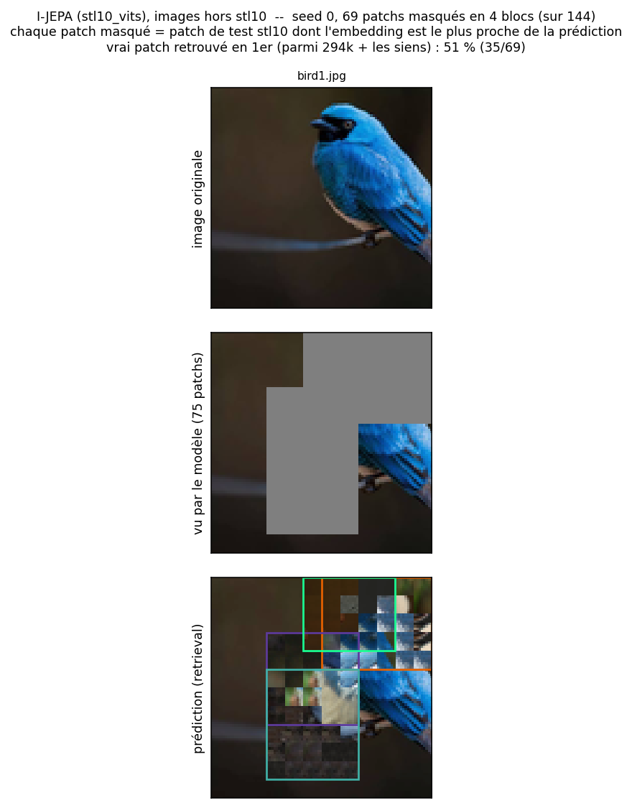

# Synthèse des résultats — I-JEPA

Deux runs :
- `cifar10_d128` (13–14/10/2026) : CIFAR-10 32×32, ViT d = 128, sur CPU, sections 1 à 5 ;
- `stl10_vits` (12/11/2026) : STL-10 96×96, ViT-Small d = 384, sur GPU du labo ETIS, section 6.

## En bref

| Vérification | `cifar10_d128` | `stl10_vits` | Verdict |
|---|---|---|---|
| Tests unitaires (`pytest`) | 265 passés, 0 échec (12/11/2026) | idem | ✅ |
| Pré-entraînement | 30/30 epochs, loss finale 0,260 | 100/100 epochs, loss finale 0,397 | ✅ terminés |
| Collapse de l'encodeur cible | std normalisée 0,087 (idéal ~0,088), 0 dim. morte | std normalisée 0,051 (idéal ~0,051), 0 dim. morte | ✅ pas de collapse |
| Qualité des représentations (linear probe) | 56,6 % en test (aléatoire : 45,0 %) | **74,1 %** en test (aléatoire : 45,7 %) | ✅ +11,6 / **+28,4 points** |

## 1. Tests unitaires

`python -m pytest -q` : **265 passed** en 5 min 39 s, sur 10 fichiers (attention, config, data, masking, model, patching, predictor, train, transformer, visualise), le 12/11/2026. Au moment du run (13–14/10), il y en avait 157.
Les 767 warnings sont des `DeprecationWarning` de NumPy 2 / gast, sans impact sur les résultats.

## 2. Pré-entraînement

| Paramètre | Valeur |
|---|---|
| Données | CIFAR-10 train, patchs 4×4 (grille 8×8, 64 tokens) |
| Encodeur | ViT, d = 128, 4 blocs, 4 têtes |
| Prédicteur | d = 64, 2 blocs |
| Paramètres | 916,4K entraînables, 820,1K gelés (encodeur cible, positions) |
| Schedule | 30 epochs × 390 steps = 11 700 steps, batch 128 |
| LR | warmup linéaire 3 epochs jusqu'à 1e-3, puis cosine jusqu'à 0 |
| EMA | 0,996 → 1,0 |
| Matériel | CPU uniquement (pas de GPU TensorFlow sous Windows natif), ~8 min/epoch, ~4 h au total |

### Évolution de la loss


*Généré par `plot_loss.py` à partir de `logs/cifar10_d128.log` (loss loggée tous les 50 steps).*

| Epoch | 1 | 2 | 5 | 10 | 15 | 20 | 25 | 30 |
|---|---|---|---|---|---|---|---|---|
| Loss moyenne | 0,449 | 0,158 | 0,195 | 0,246 | 0,276 | 0,279 | 0,269 | 0,260 |

- Chute très rapide pendant le warmup : minimum **0,151 au step 550**.
- Remontée progressive jusqu'à ~0,28 vers l'epoch 15–18, puis légère baisse jusqu'à **0,265** au dernier step.
- Cette remontée est attendue en JEPA : la cible (encodeur EMA) devient plus riche, donc plus dure à prédire. La section 3 confirme que ce n'était pas un collapse.

## 3. Vérification du collapse

Script : `check_collapse.py`, sur 1 024 images de test. Encodeur cible entraîné comparé à un encodeur aléatoire.

| Encodeur | Std normalisée | Dims mortes | Rang effectif (par image) | Rang effectif (par token) |
|---|---|---|---|---|
| Aléatoire (réf.) | 0,082 | 0 | 37,2 | 59,4 |
| **Entraîné** | **0,087** | **0** | **65,3** | **86,6** |

*Std normalisée : écart-type par dimension après normalisation L2 (collapse → 0, idéal ≈ 1/√128 ≈ 0,088). Rang effectif : exponentielle de l'entropie des valeurs singulières (max 128).*

- Les embeddings sont bien étalés et aucune dimension n'est morte.
- Le rang effectif est presque **doublé** par rapport à l'aléatoire : l'entraînement a enrichi les représentations.
- La loss très basse au début n'était qu'une phase transitoire.

## 4. Visualisation des prédictions

Script : `predicted_fill.py`. I-JEPA prédit des embeddings, pas des pixels. Chaque patch masqué est donc remplacé par le patch d'une **autre** image de test dont l'embedding (encodeur cible) est le plus proche de la prédiction. La banque contient 2 048 images, soit 131k patchs.


- Le vrai patch est le plus proche voisin de sa prédiction dans **51 % des cas** (40/78), parmi 131k candidats.
- Les patchs retrouvés sont cohérents en couleur et en texture : fond bleu-gris, pelage brun, herbe sèche. Pour les zones d'objet, la cohérence de forme est plus faible.

## 5. Linear probe

Script : `linear_probe.py` (ajouté le 12/11/2026). L'encodeur cible est figé ; chaque image devient la moyenne de ses 64 tokens, puis une régression logistique apprend les 10 classes sur les 50k images de train (sans augmentation). La régularisation C est choisie sur 10 % du train mis de côté.

| Encodeur | Précision test | Précision train | C retenu |
|---|---|---|---|
| Aléatoire (réf.) | 45,0 % | 45,0 % | 10 |
| **Entraîné** | **56,6 %** | 57,5 % | 1 |

- Le pré-entraînement apporte **+11,6 points** sur un encodeur aléatoire de même architecture : les représentations contiennent de l'information de classe, sans avoir jamais vu une étiquette.
- L'encodeur aléatoire est déjà à 45 % : sur des images 32×32, des projections aléatoires de patchs captent déjà les couleurs et les textures dominantes de chaque classe.
- Ce chiffre reste loin des résultats publiés pour de gros ViT, ce qui est cohérent avec un modèle de 0,9 M de paramètres entraîné 4 h sur CPU. Il sert de **référence** pour comparer les prochains runs (`cifar10_d256`, `stl10_vits`).

## 6. Run `stl10_vits` : STL-10 96×96, ViT-Small, GPU

*Run du 12/11/2026, checkpoint `checkpoints/stl10_vits/jepa.weights.h5`.*

### Pré-entraînement

| Paramètre | Valeur |
|---|---|
| Données | STL-10 `unlabelled` (100k images) en 96×96 natif, patchs 8×8 (grille 12×12, 144 tokens) |
| Encodeur | ViT-Small, d = 384, 12 blocs, 6 têtes |
| Prédicteur | d = 192, 6 blocs, 6 têtes |
| Paramètres | 24,2M entraînables, 21,5M gelés (encodeur cible, positions) |
| Schedule | 100 epochs × 390 steps = 39 000 steps, batch 256 |
| LR | warmup linéaire 10 epochs jusqu'à 5e-4, puis cosine jusqu'à 0 |
| EMA | 0,996 → 1,0 |
| Matériel | 1 NVIDIA RTX PRO 6000 Blackwell (serveur ETIS), ~112 s/epoch (~0,29 s/step), ~3 h 10 au total |



*Généré par `plot_loss.py --run stl10_vits` à partir de `logs/stl10_vits.log` (minimum 0,095 au step 750).*

| Epoch | 1 | 2 | 3 | 20 | 65 | 70 | 80 | 90 | 100 |
|---|---|---|---|---|---|---|---|---|---|
| Loss moyenne | 0,531 | 0,108 | 0,105 | 0,283 | 0,420 | 0,411 | 0,398 | 0,391 | 0,397 |

- Même profil que sur CIFAR-10 : minimum très tôt (0,105 à l'epoch 3), remontée jusqu'à un pic vers 0,42 (epochs 65–68), puis légère baisse quand le LR tend vers 0 et l'EMA vers 1.
- La remontée est plus forte qu'avec `cifar10_d128`. Une partie vient de l'échelle des embeddings : la std brute de l'encodeur cible passe de 0,47 (aléatoire) à 0,85 par image et de 0,58 à 1,24 par token. La loss est une MSE non normalisée, donc elle grandit avec cette échelle. L'article I-JEPA normalise les cibles (layer norm sans paramètres) avant la loss ; ce n'est pas fait ici.

### Vérification du collapse

`check_collapse.py`, sur 2 048 images de test.

| Encodeur | Std brute (image / token) | Std normalisée (image / token) | Dims mortes | Rang effectif (par image) | Rang effectif (par token) |
|---|---|---|---|---|---|
| Aléatoire (réf.) | 0,472 / 0,575 | 0,0483 / 0,0492 | 0 | 94,4 | 165,8 |
| **Entraîné** | 0,846 / 1,244 | **0,0507 / 0,0506** | **0** | **227,8** | **291,5** |

*Idéal ≈ 1/√384 ≈ 0,051 ; rang effectif max 384.*

- Std normalisée pile à l'idéal, aucune dimension morte : pas de collapse.
- Le rang effectif est multiplié par **2,4** par image (94 → 228) et par 1,8 par token : les représentations utilisent bien plus de directions que l'aléatoire.

### Visualisation des prédictions

`predicted_fill.py --run stl10_vits` : banque de 2 048 images de test, soit 294k patchs.



- Le vrai patch est le plus proche voisin de sa prédiction dans **68 % des cas** (140/207), contre 51 % pour `cifar10_d128` avec une banque plus de 2× plus grande.
- Le modèle respecte la **disposition** de la scène et plus seulement les couleurs : sur le cargo, la coque rouge et noire est prolongée à la bonne hauteur, avec l'eau dessous et le ciel dessus ; sur le paquebot, les étages à hublots et le quai sont à peu près à leur place.
- Les détails fins (œil, bride du cheval) ne sont pas retrouvés, et les zones avec peu de contexte autour restent approximatives.

Sur une image hors dataset (`experimentation/test_image.py --run stl10_vits img/bird1.jpg`) :



- Vrai patch retrouvé dans **51 %** des cas (35/69), contre ~46 % avec `cifar10_d128`.
- Du bleu apparaît là où se trouve le corps de l'oiseau et le fond sombre est retrouvé, alors que la v1 remplissait la zone de textures brun-vert. La tête noire, l'œil et la branche ne sont pas reconstruits ; le masque cachait presque tout l'oiseau.

### Linear probe

`linear_probe.py`, splits annotés de STL-10 (5k train / 8k test), 10 classes, moyenne des 144 tokens.

| Encodeur | Précision test | Précision train | C retenu |
|---|---|---|---|
| Aléatoire (réf.) | 45,7 % | 60,8 % | 1 |
| **Entraîné** | **74,1 %** | 80,6 % | 0,01 |

- **+28,4 points** sur l'encodeur aléatoire, contre +11,6 pour `cifar10_d128` : plus de résolution, plus de données et un modèle 26× plus grand donnent des représentations nettement plus utiles.
- L'écart train/test reste modéré (6,5 points) malgré seulement 5k images annotées ; le C retenu est petit (forte régularisation), ce qui est cohérent avec 384 dimensions pour 4,5k exemples.
- Les deux chiffres ne sont pas sur le même jeu de test (CIFAR-10 contre STL-10) ; la comparaison directe se fera avec `stl10_d128` / `stl10_d256` une fois entraînés.

## 7. Limites et prochaines étapes

- Loss loggée tous les 50 steps seulement : modifier `jepa/train.py` pour une courbe step par step.
- Normaliser les cibles avant la loss, comme dans l'article I-JEPA, à tester sur un run séparé.
- Comparer à `stl10_d128` / `stl10_d256` pour isoler l'effet de la taille du modèle.

## Reproduire

```bash
python -m pytest -q                       # tests unitaires
python -m jepa.train --run cifar10_d128 > logs/cifar10_d128.log 2>&1  # pré-entraînement (~4 h sur CPU)
python result_analysis/plot_loss.py --run cifar10_d128       # courbe de loss
python result_analysis/check_collapse.py --run cifar10_d128  # vérification du collapse
python result_analysis/predicted_fill.py --run cifar10_d128  # visualisation des prédictions
python result_analysis/linear_probe.py --run cifar10_d128    # linear probe (~5 min sur CPU)

# stl10_vits, sur GPU Linux (requirements-gpu.txt)
python -u -m jepa.train --run stl10_vits --resume >> logs/stl10_vits.log 2>&1  # ~3 h 10
python result_analysis/check_collapse.py --run stl10_vits
python result_analysis/linear_probe.py --run stl10_vits     # ~2 min sur GPU
```
